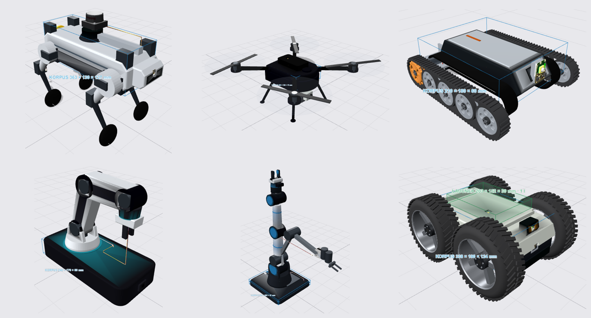
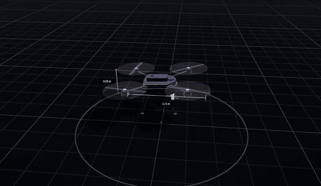
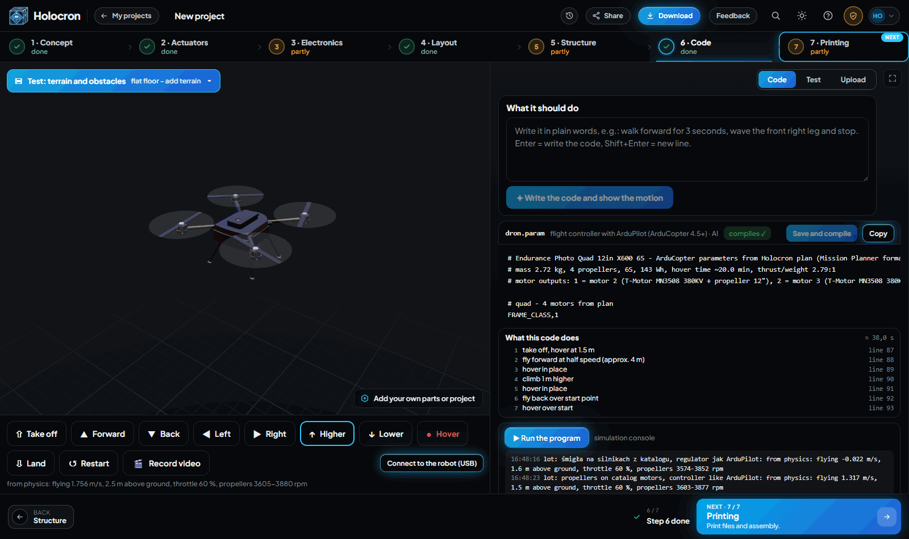

<div align="center">

# Holocron Engine

**Describe a robot in plain words. Get a design you can build.**

Mechanics, electronics, firmware and a physics simulation that actually moves, in one pipeline.

[**Try it in the browser**](https://app.holocron-engine.com) · [Report a bug](https://github.com/TomaszKumoe/holocron-engine/issues)



<sub>All six were designed end to end in Holocron: quadruped, drone, tracked rover, desktop arm, 6-axis arm and 4×4 rover.</sub>

</div>

---

## What it does

You type something like *"a small quadruped with 12 serial servos that walks on a desk and avoids obstacles"*. Holocron takes it through seven steps, and every step is checked by an algorithm, not just generated:

| Step | What you get |
|---|---|
| **1. Concept** | The robot's form, drawn by an AI designer within the limits of real parts |
| **2. Actuators** | Motors and servos picked from a real catalogue, with torque headroom checked |
| **3. Electronics** | Board, battery, sensors, wiring diagram, wire gauges and pin map |
| **4. Layout** | Where every part sits inside the body, in 2D and 3D |
| **5. Structure** | Frame, mounts and cable routing inside the shell, plus a physics check |
| **6. Code** | Firmware for the real board, tested on a virtual board in MuJoCo |
| **7. Printing** | The shell cut into printable parts |

Supported robot types today: quadrupeds, humanoids, arms, wheeled and tracked rovers, and drones.

## See it move



The quadcopter above flies in MuJoCo on its catalogue motors and propellers, with a controller modelled on ArduPilot. Holocron also writes the matching ArduCopter parameter file.



<sub><b>Code step.</b> Generated firmware next to the live simulation. Take off, fly, climb and land are one click each, and the console shows speed, height, throttle and propeller rpm from physics.</sub>

## Why

Building a robot today means jumping between CAD, a parts spreadsheet, a wiring tool, an IDE and a simulator, and none of them know about each other. Change the battery and you redo half the work by hand.

Holocron keeps the whole robot as one model. Change one thing and it tells you what else is affected, then updates only the steps that need it.

## Built on

[MuJoCo](https://github.com/google-deepmind/mujoco) for physics, [CadQuery](https://github.com/CadQuery/cadquery) for geometry, [trimesh](https://github.com/mikedh/trimesh), [yourdfpy](https://github.com/clemense/yourdfpy), [CHAMP](https://github.com/chvmp/champ) for legged gaits, React and three.js for the interface, FastAPI for the backend.

## Run locally

```bash
git clone https://github.com/TomaszKumoe/holocron-engine.git
cd holocron-engine
pip install -r requirements.txt
python backend/server.py
```

Then open http://localhost:8300. Accounts and AI steps need your own keys in `backend/.env`: a Supabase project and an OpenRouter API key.

## Status

Early and moving fast. The hosted version at [app.holocron-engine.com](https://app.holocron-engine.com) is the newest. Issues and ideas are welcome.

If this is useful to you, a ⭐ helps other robot builders find it.

## License

[Apache-2.0](LICENSE). Third-party components keep their own licenses, see [NOTICE](NOTICE).
